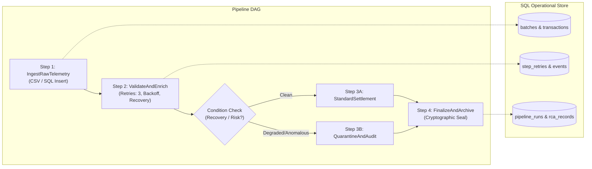

# Architecture & Design Decision Record (ADR)
**Candidate:** Shivankar Tripathi  
**Assignment ID:** DAI-045 | **Primary Track:** DataOps  
**Title:** Dependency-Aware Orchestration with Operational Telemetry & Auto-Recovery  
**Date:** October 2026 | **Status:** APPROVED & IMPLEMENTED  

---

## 1. Problem Statement & Operational Context
Modern mission-critical data pipelines often suffer from cascading failures caused by transient upstream timeouts, uncoordinated retry storms ("thundering herd"), and silent data corruption. The objective of this system is to build an embedded, dependency-aware orchestration engine that enforces strict DAG execution, traps transient network faults, automatically self-heals via exponential backoff with jitter, captures granular operational metadata in SQL, and synthesizes an SRE-grade Root Cause Analysis (RCA) note without human intervention.

---

## 2. Core Architectural Decisions

### ADR-01: Embedded DAG Engine vs Heavyweight Schedulers (Airflow/Prefect)
- **Decision:** Build a pure-Python, zero-broker DAG execution engine supporting topological sorting, cycle detection, and fine-grained step lifecycle hooks.
- **Rationale:** External workflow managers (e.g., Airflow, Celery) require heavy external services (Redis, PostgreSQL, worker daemons) that add severe deployment overhead and operational friction for clean setup. An embedded DAG runner provides sub-millisecond execution overhead, zero setup dependencies, and direct in-memory context propagation with strict dependency guarantees (`ALL` vs `ONE_OF`).

### ADR-02: Relational SQL Persistence for Operational Telemetry & Transactions
- **Decision:** Combine SQLite 3 with strict foreign key constraints (`PRAGMA foreign_keys = ON`) and transactional context managers.
- **Rationale:** Storing pipeline execution runs, step statuses, retry latencies, events, and business records (`batches`, `transactions`) in SQL ensures ACID compliance and enables direct SQL querying (`v_pipeline_run_summary`). SQLite eliminates database provisioning hurdles while maintaining full relational fidelity.

### ADR-03: Exponential Backoff with Randomized Jitter & Degradation Routing
- **Decision:** Implement a configurable `RetryPolicy` combining exponential backoff (`delay = initial * factor^(attempt-1)`) with randomized jitter (±20%), paired with a dynamic conditional branch.
- **Rationale:** Jitter desynchronizes concurrent retries to prevent thundering-herd starvation on recovering upstream services. When transient retries succeed, the step marks state as `RECOVERED`; downstream conditional branching observes this degraded recovery state and directs traffic to `QuarantineAndAuditDispatch` rather than the standard path.

### ADR-04: Strict AI Isolation Behind an Abstract Provider Interface
- **Decision:** Encapsulate all operational intelligence behind an `AbstractRCAEnhancer` interface with a deterministic `HeuristicRCAEnhancer` and an optional `LLMRCAEnhancer` (supporting Ollama and OpenAI-compatible endpoints).
- **Rationale:** Production pipelines must run reliably in air-gapped, zero-credential, or offline environments. Isolating AI calls behind a protocol ensures the pipeline never crashes if an external LLM endpoint is unreachable, automatically falling back to rule-based SRE deductions.

---

## 3. Data Model & Execution Graph

---

## 4. Trade-Offs Considered
| Approach | Selected | Alternative | Trade-Off Rationale |
| :--- | :---: | :--- | :--- |
| **Orchestration** | **Embedded DAG** | Apache Airflow / Celery | Avoided daemon/broker overhead; ensures instant clean-setup execution. |
| **SQL Engine** | **SQLite 3** | PostgreSQL / MySQL | Zero external service installation; fully relational and file-backed. |
| **Retry Strategy** | **Backoff + Jitter** | Fixed Interval Retry | Fixed retries cause upstream starvation; jitter ensures smooth recovery. |
| **AI Layer** | **Interface + Fallback** | Hardcoded OpenAI API | Eliminates hard credential dependencies; 100% resilient offline. |

---

## 5. Security & Operational Guarantees
1. **Zero Secrets in Code:** Environment configuration managed via `.env.example` and environment variables.
2. **Synthetic Data Exclusivity:** All datasets are generated procedurally with realistic financial distributions.
3. **Data Loss Prevention:** 100% record retention verified through cryptographic SHA-256 batch seals and forensic quarantine audit logs.
