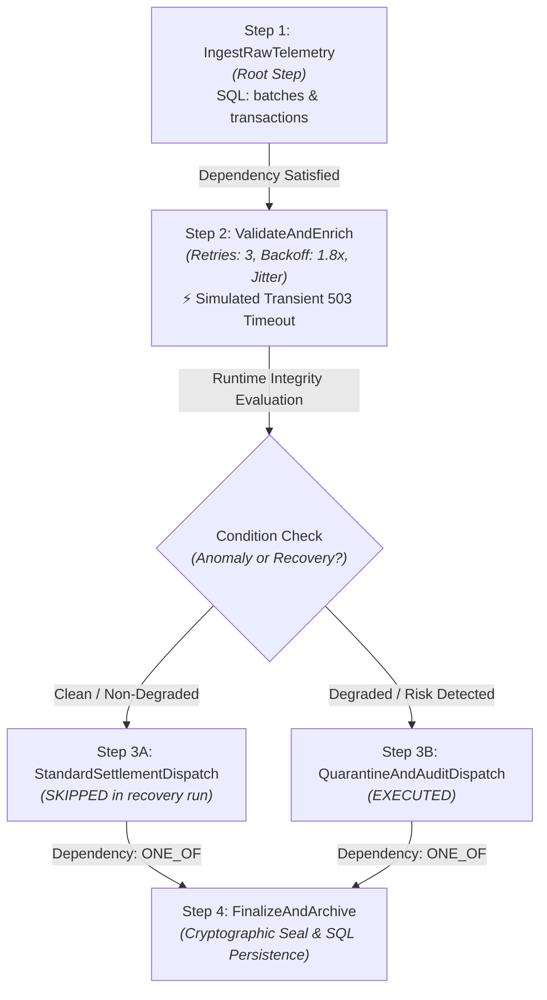

# Dependency-Aware Orchestration Engine (DataOps Track)

**Candidate:** Shivankar Tripathi  
**Assignment ID:** DAI-045 | **Primary Track:** DataOps  
**Assignment Title:** Dependency-Aware Orchestration with Telemetry & Auto-Recovery  

[](https://www.python.org/)
[-green.svg)](https://www.sqlite.org/)
[]()
[]()

A production-grade Python + SQL DAG orchestration pipeline with explicit step dependencies, exponential backoff retries with randomized jitter, dynamic conditional branching, automated self-healing from transient faults, real-time operational metadata collection, and SRE-standard Root Cause Analysis (RCA) reporting.

---

## 1. Pipeline Architecture (DAG)



### 4-Step Lifecycle Breakdown

1. **Step 1: Data Ingestion (`IngestRawTelemetry`)**
   - Root step without upstream dependencies.
   - Ingests synthetic transactional batches from CSV/JSON, calculates cryptographic SHA-256 payload checksums, and persists initial state into SQLite `batches` and `transactions` tables.
2. **Step 2: Validation & Enrichment (`ValidateAndEnrich`)**
   - Explicit dependency: `depends_on = ["IngestRawTelemetry"]`.
   - Simulates a transient upstream timeout (`TransientUpstreamTimeoutError: HTTP 503 socket timeout / pool exhausted`).
   - Executes configurable exponential backoff retries with randomized jitter (`attempt 1` -> fail, `attempt 2` -> fail, `attempt 3` -> **recovers**).
   - Enriches transactions with FX exchange rates, updates SQLite records, and flags state as `RECOVERED`.
3. **Step 3: Conditional Branching (`ConditionalDispatch`)**
   - Explicit dependency: `depends_on = ["ValidateAndEnrich"]`.
   - Evaluates runtime metadata:
     - **Branch 3A (`StandardSettlementDispatch`)**: Fast automated settlement for clean, non-degraded batches.
     - **Branch 3B (`QuarantineAndAuditDispatch`)**: Strict compliance audit for degraded batches or high-risk records.
   - When recovery occurs, Branch 3B executes while Branch 3A is cleanly marked as `SKIPPED`. Updates SQL records to `SETTLED` or `QUARANTINED`.
4. **Step 4: Finalization & Commit (`FinalizeAndArchive`)**
   - Explicit dependency: `depends_on = ["StandardSettlementDispatch", "QuarantineAndAuditDispatch"]` with `dependency_mode="ONE_OF"`.
   - Seals batch records with a cryptographic hash (`SEAL-...`), updates batch status to `PROCESSED`, and finalizes telemetry in SQL.

---

## 2. SQL Relational Data Model

The system uses SQLite 3 with strict foreign key constraints (`PRAGMA foreign_keys = ON`) across relational tables and views:

```
batches ───< transactions
pipeline_runs ───< pipeline_steps ───< step_retries
              └──< pipeline_events
              └──  rca_records (1-to-1)
```

- **`batches`**: Ingested batch records, payload checksums, source filenames, and status.
- **`transactions`**: Granular records with foreign exchange rates, USD converted amounts, risk flags, and lifecycle statuses (`PENDING`, `VALIDATED`, `SETTLED`, `QUARANTINED`).
- **`pipeline_runs`**: High-level run telemetry, duration (ms), host details, process ID, memory RSS (MB), and cryptographic seals.
- **`pipeline_steps`**: Step status (`SUCCESS`, `RECOVERED`, `SKIPPED`, `FAILED`), execution duration, and attempt counts.
- **`step_retries`**: Granular audit log of each failed retry, exception class, error message, backoff delay, and stack trace snippet.
- **`pipeline_events`**: Chronological event stream with levels (`INFO`, `WARN`, `RETRY`, `RECOVERY`, `ERROR`).
- **`rca_records`**: Formal SRE incident analysis records with JSON-structured 5-Whys and CAPA action items.
- **`v_pipeline_run_summary`**: Analytical view aggregating step counts, recovery indicators, and total retries per run.

---

## 3. AI Isolation & Abstract Intelligence Interface

All AI and incident intelligence calls are strictly isolated behind the [`AbstractRCAEnhancer`](file:///c:/Users/hp/Desktop/Bytespoke/ai/interface.py) interface:

- **`HeuristicRCAEnhancer`** *(Default)*: Deterministic, zero-dependency local reasoning engine. Analyzes stack traces, retry histories, and host metrics offline with zero external network calls or API keys.
- **`LLMRCAEnhancer`**: Pluggable provider for local models (Ollama, llama.cpp, vLLM) or remote OpenAI-compatible endpoints. Automatically falls back to the heuristic provider if the LLM is unreachable or unconfigured.

Configure via `.env`:
```bash
AI_PROVIDER=heuristic  # 'heuristic', 'ollama', or 'openai'
AI_API_BASE=http://localhost:11434/v1
AI_MODEL=llama3.2
```

---

## 4. Quickstart & Clean Setup

### Prerequisites
- Python 3.10+ (Standard Library contains `sqlite3`, `ctypes`, `dataclasses`, `unittest`)
- No external databases or message brokers required.

### 1. Clone & Set Up Environment
```bash
git clone https://github.com/ShivankarTripathi/dataops-orchestration.git
cd dataops-orchestration

# Optional: configure environment
cp .env.example .env

# Install minimal UI rendering dependency
pip install -r requirements.txt
```

### 2. Run the End-to-End Resilient Pipeline
```bash
python run_pipeline.py
```
*Executes the 4-step pipeline, demonstrates transient failure and recovery, logs SQL telemetry, and generates the RCA note.*

### 3. Run the Failure Modes & Edge-Cases Demonstration
```bash
python demo_failure_modes.py
```
*Demonstrates 4 distinct failure scenarios: clean run, transient auto-recovery, permanent retry exhaustion with fallback handler, and corrupted payload edge cases.*

### 4. Run the Automated Test Suite
```bash
python -m unittest discover -s tests -v
```
*Executes 10 unit and integration tests verifying DAG dependencies, cycle detection, SQL queries, AI interface fallback, and recovery.*

---

## 5. Generated Deliverables & Artifacts

- **1-Page Design/Decision Note:** [`DESIGN_DECISION_NOTE.md`](file:///c:/Users/hp/Desktop/Bytespoke/DESIGN_DECISION_NOTE.md)
- **5–8 Min Demo Video Script:** [`DEMO_SCRIPT.md`](file:///c:/Users/hp/Desktop/Bytespoke/DEMO_SCRIPT.md)
- **SRE Incident RCA Note:** [`artifacts/RCA_INCIDENT_REPORT.md`](file:///c:/Users/hp/Desktop/Bytespoke/artifacts/RCA_INCIDENT_REPORT.md)
- **Operational Metadata Export:** [`artifacts/operational_metadata.json`](file:///c:/Users/hp/Desktop/Bytespoke/artifacts/operational_metadata.json)
- **SQLite Database:** `pipeline_ops.db` (created automatically upon execution)
